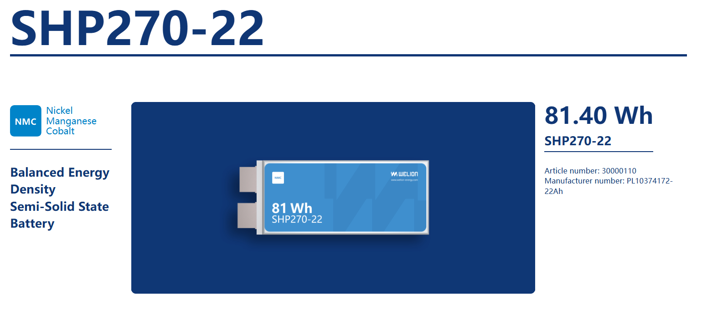
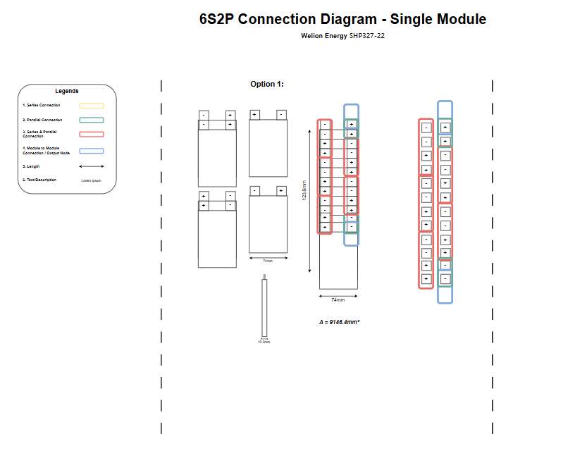
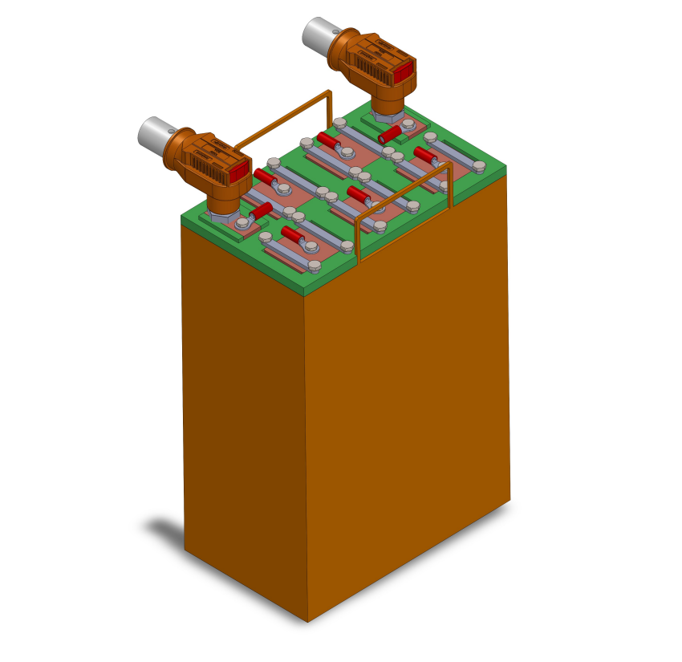
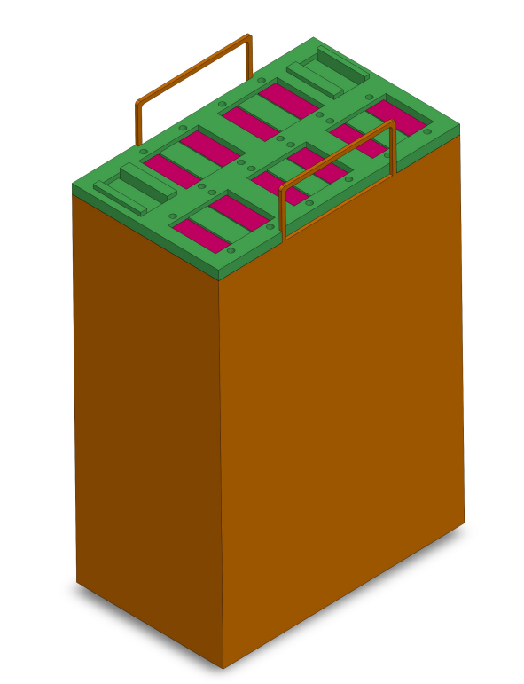
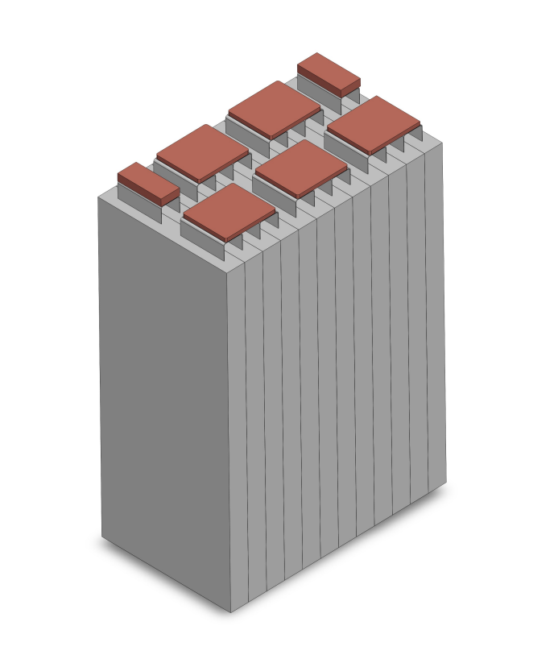

# Battery Pack Design | Formula Student EV

A high-voltage battery pack developed for a Formula Student Electric Vehicle, featuring a modular **102S2P configuration**, with a nominal voltage of **377.4 V**, maximum voltage of **428.4 V**, and a total capacity of **44 Ah**.

The battery pack is designed to meet the vehicle's energy requirements and supply electrical power to a **Cascadia Motion CM200DX inverter**, paired with an **EMRAX 208 MV LC electric motor**.

This repository documents the battery architecture, cell configuration, module design, electrical calculations, and powertrain integration.

---

## Table of Contents

- [Overview](#overview)
- [Battery Specifications](#battery-specifications)
- [Battery Cell](#battery-cell)
- [Battery Architecture](#battery-architecture)
- [Battery Module Design](#battery-module-design)
- [Energy Capacity and Sizing](#energy-capacity-and-sizing)
- [Powertrain Integration](#powertrain-integration)
- [Battery Management System Integration](#battery-management-system-integration)
- [Design Documentation](#design-documentation)
- [Repository Structure](#repository-structure)
- [Project Status](#project-status)
- [Disclaimer](#disclaimer)

---

## Overview

The battery pack serves as the primary energy storage system for the electric vehicle. Its configuration is developed around the electrical and energy requirements of the vehicle's powertrain, with considerations for voltage, current capability, energy capacity, battery monitoring, and system integration.

The pack consists of **17 individual battery modules**, each configured as **6S2P**, resulting in an overall configuration of **102S2P**.

### Battery Specifications

| Parameter | Specification |
|---|---|
| Application | Formula Student Electric Vehicle |
| Manufacturer | Welion Energy |
| Cell Model | SHP270-22 |
| Cell Type | Pouch |
| Chemistry | NMC |
| Pack Configuration | 102S2P |
| Number of Modules | 17 |
| Module Configuration | 6S2P |
| Total Individual Cells | 204 |
| Nominal Pack Voltage | 377.4 V |
| Maximum Pack Voltage | 428.4 V |
| Pack Capacity | 44 Ah |
| Pack Current | 220 A |
| Nominal Pack Energy | 16,605.6 Wh |
| Nominal Pack Energy | 16.61 kWh |
| Target Energy Requirement | 3,530 Wh |
| Intended Depth of Discharge | 80% |

---

## Battery Cell

The battery pack utilizes the **Welion Energy SHP270-22** pouch cell, featuring Nickel Manganese Cobalt (NMC) chemistry.

The cells are arranged in a series-parallel configuration to achieve the required pack voltage and capacity.

### Cell Specifications

| Parameter | Specification |
|---|---|
| Manufacturer | Welion Energy |
| Model | SHP270-22 |
| Cell Type | Pouch |
| Chemistry | NMC |
| Nominal Cell Voltage | 3.7 V |
| Maximum Cell Voltage | 4.2 V |

### Cell Reference

---

## Battery Architecture

The battery pack uses a modular architecture to organize individual cells into manageable battery modules.

Each module contains 12 individual cells arranged in a 6S2P configuration. Seventeen modules are connected in series to form the complete 102S2P battery pack.

### Pack Configuration

- 17 battery modules connected in series.
- Each module contains 6 series-connected cell groups.
- Each cell group consists of 2 parallel-connected cells.
- Each module contains 12 individual cells.
- The complete pack contains 102 series-connected cell groups and 204 individual cells.

### Configuration Breakdown

| Level | Configuration |
|---|---|
| Individual Cell Group | 2P |
| Battery Module | 6S2P |
| Complete Battery Pack | 102S2P |

---

## Battery Module Design

Each battery module is designed around a 6S2P configuration, providing six independently measurable series cell groups.

Seventeen modules are connected in series to achieve the complete pack configuration.

### Module Specifications

| Parameter | Specification |
|---|---|
| Module Configuration | 6S2P |
| Series Groups | 6 |
| Parallel Cells per Group | 2 |
| Total Cells per Module | 12 |
| Number of Modules | 17 |
| Nominal Module Voltage | 22.2 V |
| Maximum Module Voltage | 25.2 V |
| Module Capacity | 44 Ah |

### Module Layout

---

## Energy Capacity and Sizing

The battery pack is designed to accommodate the vehicle's target energy requirement of **3,530 Wh**.

With a total nominal energy capacity of 16,605.6 Wh, the pack is intended to operate within an 80% Depth of Discharge (DoD) limit, retaining approximately 20% of its nominal capacity as an energy reserve.

### Nominal Energy Calculation

The nominal energy capacity is calculated using the nominal pack voltage and total battery capacity:

$$
E_{\text{nominal}} = V_{\text{nominal}} \times C_{\text{pack}}
$$

$$
E_{\text{nominal}} = 377.4 \times 44
$$

$$
\boxed{E_{\text{nominal}} = 16,605.6\text{ Wh}}
$$

### Usable Energy at 80% DoD

The theoretical usable energy at 80% DoD is:

$$
E_{\text{usable}} = E_{\text{nominal}} \times 0.80
$$

$$
E_{\text{usable}} = 16,605.6 \times 0.80
$$

$$
\boxed{E_{\text{usable}} = 13,284.48\text{ Wh}}
$$

### Required Nominal Energy

To supply the target energy requirement of 3,530 Wh while maintaining an 80% DoD limit:

$$
E_{\text{required}} = \frac{3,530}{0.80}
$$

$$
\boxed{E_{\text{required}} = 4,412.5\text{ Wh}}
$$

### Energy Comparison

| Parameter | Energy |
|---|---:|
| Target Energy Requirement | 3,530 Wh |
| Minimum Nominal Energy Required | 4,412.5 Wh |
| Battery Pack Nominal Energy | 16,605.6 Wh |
| Usable Energy at 80% DoD | 13,284.48 Wh |
| Usable Energy Margin | 9,754.48 Wh |

The resulting usable energy is approximately **3.76 times the target energy requirement**.

This provides a substantial energy capacity margin for the vehicle's intended operation. Actual usable energy will depend on operating conditions, cell characteristics, temperature, discharge rate, and system losses.

---

## Powertrain Integration

The battery pack serves as the primary DC energy source for the vehicle's electric powertrain.

The electrical energy stored in the battery is supplied to the inverter, which controls the electrical power delivered to the electric motor.

### Powertrain Components

| Component | Model | Function |
|---|---|---|
| Battery Pack | 102S2P | High-voltage energy storage |
| Inverter | Cascadia Motion CM200DX | Motor power conversion and control |
| Electric Motor | EMRAX 208 MV LC | Electric propulsion |

### System Integration

The battery pack is intended to supply DC electrical power to the **Cascadia Motion CM200DX inverter**, which drives the **EMRAX 208 MV LC electric motor**.

The battery voltage and current configuration are developed around the electrical requirements of the inverter and motor system.

Key integration considerations include:

- DC voltage compatibility between the battery pack and inverter.
- Pack current capability and powertrain demand.
- Electrical interconnections and high-voltage distribution.
- Battery monitoring and protection.
- Thermal management and operating temperature.
- System-level electrical safety.

---

## Battery Management System Integration

The battery pack operates alongside a dedicated Battery Management System (BMS), responsible for monitoring battery operating conditions.

The BMS follows a master-slave architecture consisting of an STM32G4-based master controller and LTC6810-based slave monitoring units.

### Monitoring Architecture

- Cell-group voltage monitoring across all 17 modules.
- Up to 4 NTC thermistors per module.
- Up to 102 voltage measurement channels across the complete pack.
- Up to 68 temperature measurement channels across the complete pack.
- Centralized data acquisition and monitoring through the master controller.
- isoSPI daisy-chain communication between monitoring ICs.

For further technical details, refer to the dedicated BMS repository:

**[BMS Master STM32G4 & Slave LTC6810](../BMS-Master-STM32G4-Slave-LTC6810)**

---

## Design Documentation

This section contains supporting design files, visual references, and engineering documentation related to the battery pack.

### Battery Module Assembly

### Cell Holder

### Battery Interconnections

---

---

## Project Status

| Development Area | Status |
|---|---|
| Battery Configuration | Completed |
| Cell Selection | Completed |
| Module Configuration | Completed |
| Energy Sizing | Completed |
| Powertrain Component Selection | Completed |
| Electrical Design | In Development |
| Mechanical Design | In Development |
| BMS Integration | In Development |
| System Validation | Ongoing |

---

## Disclaimer

This repository documents an engineering development project for a Formula Student electric vehicle.

The presented design and specifications should not be considered production-ready or suitable for direct implementation without appropriate engineering review, electrical validation, and safety testing.

High-voltage battery systems require appropriate insulation, overcurrent protection, monitoring, and handling procedures.

---

## Acknowledgment

Developed as part of the **Anargya ITS Formula Student Electric Vehicle Project**, focusing on battery energy storage, electrical system integration, and vehicle powertrain requirements.
